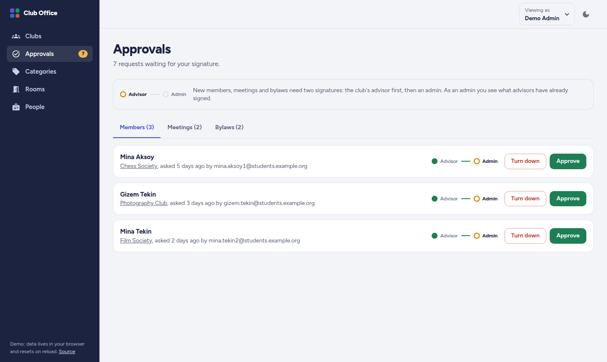
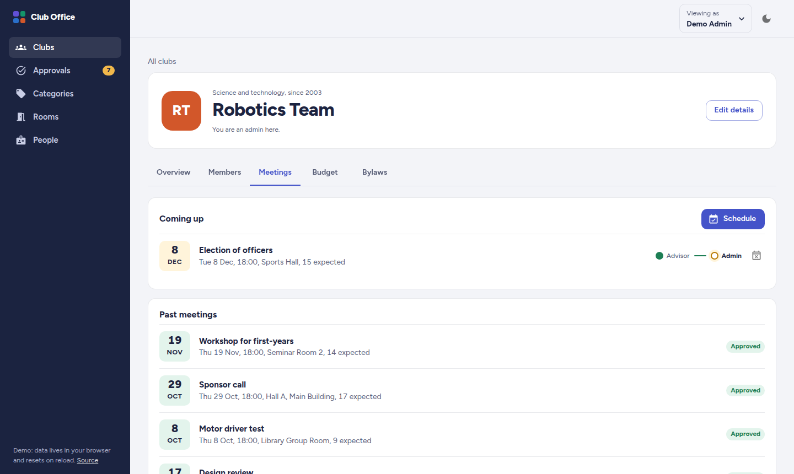
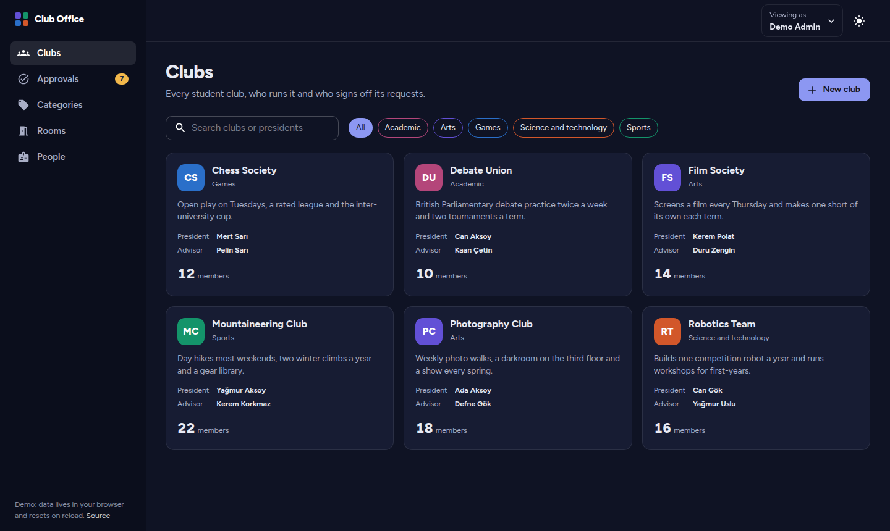

# org-management-console

The admin console for a university's student clubs: who runs each club, its members, meetings, books and bylaws, and one queue for everything that needs sign-off. React 18 and MUI 5. The backend is [org-management-service](https://github.com/Omercanbasboga/org-management-service).

**Live demo:** https://omercanbasboga.github.io/org-management-console/ (runs on an in-browser copy of the service's rules; all data is made up and resets on reload)



## Try the approval flow

New members, meetings and bylaws need two signatures: the club's advisor first, then an admin. The demo lets you sit in either chair.

1. Open the demo and pick **Chess Society advisor**. The queue shows that club's new requests.
2. Sign one. It leaves your queue and the badge in the sidebar counts down.
3. Switch to **Demo Admin** from *Viewing as* in the top bar. The request you signed is there, now at the admin step.
4. Approve it. A meeting turns green on the club's Meetings tab; a new member shows up on the roster.

Switching persona changes more than the queue. Each club page shows your role there, and the buttons follow it: the treasurer can record expenses, the secretary can schedule meetings, a plain member sees the budget totals but not the ledger. If you try something your seat can't do, the toast shows the service's reason.

## How it's put together

- **One detail screen per club.** `OrganizationDetail` loads the club and its roster once, works out the caller's roles, and passes both to five tabs (overview, members, meetings, budget, bylaws). The tabs never fetch who you are on their own.
- **One queue for three kinds of request.** `PendingApprovalsPage` renders memberships, meetings and bylaws uploads with the same row and the same approve and turn-down actions. Each row shows where it is in the two-step flow (`StepTrack`).
- **The UI hides what you can't do; the service enforces it.** `features/organizations/roles.js` mirrors the service's role rules so buttons only show for people who can use them. The service checks again on every call.
- **Errors explain themselves.** Every request goes through `api/client.js`, which turns failures into `{ status, message }`. A 403 shows the service's own sentence ("This request is waiting for the organization's advisor.") instead of a generic error.
- **Persona-aware loading.** `useLoad` refetches when the persona changes and keeps the old data on screen while it does, so tables don't flash empty.

## Three ways to run it

```bash
npm install
npm start
```

| Setup | Environment | What happens |
| --- | --- | --- |
| Demo (default) | nothing | Requests go to `src/api/mock.js`, a copy of the service's rules running in the browser. This is what GitHub Pages serves. |
| Against the service's demo profile | `REACT_APP_API_BASE_URL=http://localhost:8082`, `REACT_APP_DEMO_HEADER=true` | Real API calls; the persona switcher sends the `X-Demo-User` header the service's demo profile reads. |
| Production | `REACT_APP_API_BASE_URL=<gateway>` | Calls go through the [sso-gateway-bff](https://github.com/Omercanbasboga/sso-gateway-bff) gateway with a session cookie. Sign-in is a redirect to the gateway's OAuth2 endpoint (`REACT_APP_OAUTH_PATH`); this app never sees a password or a token. |

For the service, allow the console's origin with `CORS_ORIGINS=http://localhost:3000`.



## A note on the UI layer

The first version of this console was built on a commercial admin template (Creative Tim's Soft UI Dashboard PRO). That template is licensed and not open source, so none of it is here. Everything in this repo is plain MUI.



## Notes

- Fonts: Figtree, self-hosted through Fontsource.
- `npm run build` also copies `index.html` to `404.html`, so deep links work on GitHub Pages.
- Names, numbers and amounts in the demo are generated.
